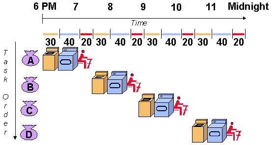
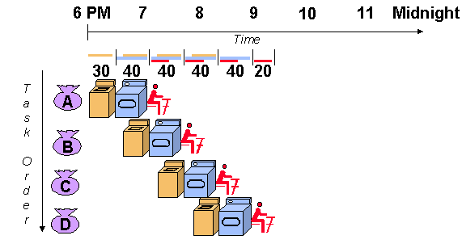

# Foreward: computer architecture class
To earn a CS degree, every student is required to take a computer architecture course.
In the course I took back as an undergrad, I learned about CPU design,
memory hierarchy, and data pipelining. Basically, it was a crash course
to hardware (without the scary electrical engineering part ó﹏ò).

I think that every developer should have a basic understanding of how hardware works.
Without a proper foundation, it can lead to unexpected software behavior.
While developing my linear algebra library, I encountered something that challenged my
understanding of hardware, and *greatly* deepened my appreciation of testing.

## Doing your laundry


Instead of waiting for a load to finish drying...



You should run another washing load at the same time! Who knew
computers could teach you so much about being an adult?

# Equivalent operations?

## A small example
Take a look at the following snippets and think about their differences.

```cpp
double a = 5.2;
double b = 3.7;

// sample 1
double c = a / b;

// sample 2
double d = a * (1.0 / b);
```

These equations are mathematically equivalent,
so they should produce the same result, right?
Printing these values out, that *seems* to be the case.

```bash
1.405405405405405 # 'c'
1.405405405405405 # 'd'
```

But, something really interesting happens when you compare them together:

```bash
# std::cout << (c == d ? "TRUE" : "FALSE");
FALSE
```

Despite what you see in stdout, the values are *not* the same.
If you increase the display precision, you'll notice something interesting.

```bash
# std::cout << std::setprecision(17);

1.4054054054054055 # 'c' - last digit ends in '5'
1.4054054054054053 # 'd' - last digit ends in '3'
```

# The bug I encountered
The previous code sample is a simplified version of what I encountered when developing
my linear algebra library. Before looking at the actual problem, I'll let you know
what led up to it.

## Custom linear algebra library
As part of the on-going development of my OpenGL renderer, I wanted to write my own
linear algebra library. I figured that it could lead to excellent learning opportunities
that I wouldn't get by using something like **glm**.

## Vector representation
```cpp
template <size_t N>
requires (N >= 1)

class Vec {
private:
    std::array<double, N> v{};

public:
    // ...
};
```

As you can see, I represent vectors as fixed-size arrays. Are there better data structures?
idk, probably.

⠀⠀⠀⠀⠀⠀⠀⠀⠀⠀⠀⠀⠀⠀⠀⠀⠀⠀⠀⠀⠀⠀⠀⠀⠀⠀⢀⣤⠶⠛⠉⠉⠉⠉⢟⡒⠲⠤⣄⡀⠀⠀⠀⠀⠀⠀⠀⠀⠀⠀⠀⠀⠀⠀⠀⠀⠀⠀⠀⠀⠀⠀⠀
⠀⠀⠀⠀⠀⠀⠀⠀⠀⠀⠀⠀⠀⠀⠀⠀⠀⠀⠀⠀⠀⠀⠀⠀⠀⣴⠋⠁⠀⠀⠀⠀⠀⣴⣟⣹⣗⡀⠈⠙⢶⡄⠀⠀⠀⠀⢀⡀⠀⠀⠀⠀⠀⠀⠀⢀⠀⣀⣀⣀⡀⠀⠀
⠀⠀⠀⠀⠀⠀⠀⠀⠀⠀⠀⠀⠀⠀⠀⠀⠀⠀⠀⠀⠀⠀⠀⢀⡾⢁⣤⡄⠀⠀⠀⠀⠀⠀⢸⡋⣿⡿⣷⠀⠀⠙⢦⡀⣠⠞⠋⠉⠛⢦⡀⠀⠀⢀⣴⢿⣿⣿⡿⠿⢟⡓⣦
⠀⠀⠀⠀⠀⠀⠀⠀⠀⠀⠀⠀⠀⠀⠀⠀⠀⠀⠀⠀⠀⠀⠀⣼⠁⣯⣴⢤⡄⠀⠀⠀⠀⠀⠘⠷⡼⠿⠃⠀⠀⠀⠈⢿⠇⠀⠀⠀⠀⠀⠻⣆⠀⠸⣧⢸⣿⡷⢶⡟⠉⠙⠛
⠀⠀⠀⠀⠀⠀⠀⠀⠀⠀⠀⠀⠀⠀⠀⠀⠀⠀⠀⠀⠀⠀⢠⡇⢸⠫⣿⢰⠇⠀⠀⠀⠀⠀⠀⠀⠀⠀⠀⠀⠀⠀⠀⢸⡇⠀⠀⠀⠀⠀⠀⢹⡆⠀⢹⡟⠉⠀⠀⢿⡀⠀⠀
⠀⠀⠀⠀⠀⠀⠀⠀⠀⠀⠀⠀⠀⠀⠀⠀⠀⠀⠀⠀⠀⠀⢸⡄⠈⠓⠚⠋⠀⠀⠀⠀⠀⠀⠀⣆⠀⠀⠀⠀⠀⠀⠀⠀⢿⠀⠀⠀⠀⠀⠀⠀⢻⡀⠀⢿⡀⠀⠀⠈⣧⠀⠀
⠀⠀⠀⠀⠀⠀⠀⠀⠀⠀⠀⠀⠀⠀⠀⠀⣠⠞⠋⠉⠓⠶⣼⡇⠀⠀⠀⠀⠀⢷⣄⣠⠴⠖⠛⠻⠆⠀⠀⠀⠀⠀⠀⠀⢸⡆⠀⢀⠀⠀⠀⠀⠈⣧⠀⠈⣧⠀⠀⠀⢹⡄⠀
⠀⠀⠀⠀⠀⠀⠀⠀⠀⠀⠀⠀⠀⠀⠀⢰⡇⠀⠀⠀⠀⠀⠘⢿⡄⠀⠀⠀⠀⠈⠁⠀⠀⠀⠀⠀⠀⠀⠀⠀⠀⠀⠀⠀⢸⡇⠀⠈⢧⠀⠀⠀⠀⠘⣇⠀⣿⠀⠀⠀⠀⣧⠀
⠀⠀⠀⠀⠀⠀⠀⠀⠀⠀⠀⠀⠀⠀⠀⣼⠀⠀⠀⠀⠀⠀⠀⠀⢳⡄⠀⠀⠀⠀⠀⠀⠀⠀⠀⠀⠀⠀⠀⠀⠀⠀⠀⠀⣾⠁⠀⠀⠸⡆⠀⠀⠀⠀⠹⣄⡿⠀⠀⠀⠀⣽⠀
⠀⠀⠀⠀⠀⠀⠀⢀⣀⣀⠀⠀⠀⠀⠀⣿⠀⠀⠀⠀⠀⠀⡀⠀⠀⠙⣦⡀⠀⠀⠀⠀⠀⠀⠀⠀⠀⠀⠀⠀⠀⠀⢀⡼⠃⠀⠀⠀⠀⠻⣦⠀⠀⠀⠀⠉⠁⠀⠀⠀⠀⡏⠀
⠀⠀⠀⠀⠀⠀⣰⣟⣇⠈⢻⡄⠀⠀⠀⢿⠀⠀⠀⠀⠀⠀⣇⠀⠀⠀⠈⠛⠦⢤⣀⣀⡀⠀⠀⠀⠀⠀⠀⣀⣠⠶⠋⠀⠀⠀⠀⠀⠀⠀⢸⢳⣄⠀⠀⠀⠀⠀⠀⠀⣸⠇⠀
⠀⠀⠀⣀⣤⣿⠷⠋⠙⠂⠐⣷⠀⠀⠀⢸⡇⠀⠀⠀⠀⠀⣿⠀⠀⠀⠀⠀⠀⠀⠀⠉⠉⠉⠉⠉⠉⠉⠉⠉⠀⠀⠀⠀⠀⠀⠀⠀⠀⠀⢸⠀⠙⢷⣄⣀⡀⠀⢀⣴⠏⠀⠀
⠀⢠⣿⣽⣭⣿⠄⠀⠀⣀⡴⠿⢷⡀⠀⠘⡇⠀⠀⠀⠀⠀⣿⡏⠀⠀⠀⠀⠀⠀⠀⠀⠀⠀⠀⠀⠀⠀⠀⠀⠀⠀⠀⠀⠀⠀⠀⠀⠀⠀⣾⠀⠀⠀⠀⠈⠉⠉⠉⠀⠀⠀⠀
⣴⢟⣩⣤⡴⠦⣴⣶⠞⠉⠀⠀⠈⣧⠀⠀⢿⠀⠀⠀⠀⠀⣿⡇⠀⠀⠀⠀⠀⠀⠀⠀⠀⠀⠀⠀⠀⠀⠀⠀⠀⠀⠀⠀⠀⠀⠀⠀⠀⠀⣿⠀⠀⠀⠀⠀⠀⠀⠀⠀⠀⠀⠀
⠛⠿⠿⠋⠀⠀⠀⣿⠀⠀⠀⠀⠀⠈⠳⣤⣼⠆⠀⠀⠀⠀⣿⡇⠀⠀⠀⠀⠀⠀⠀⠀⠀⠀⠀⠀⠀⠀⠀⠀⠀⠀⠀⠀⠀⠀⠀⠀⠀⠀⡿⠀⠀⠀⠀⠀⠀⠀⠀⠀⠀⠀⠀
⠀⠀⠀⠀⠀⠀⠀⠘⣇⠀⠀⠀⠀⠀⠀⠀⠀⠀⠀⠀⠀⢸⢻⡇⠀⠀⠀⠀⠀⠀⠀⠀⠀⠀⠀⠀⠀⠀⠀⠀⠀⠀⠀⠀⠀⠀⠀⠀⠀⠀⡇⠀⠀⠀⠀⠀⠀⠀⠀⠀⠀⠀⠀
⠀⠀⠀⠀⠀⠀⠀⠀⠸⣦⡀⠀⠀⠀⠀⠀⠀⠀⠀⠀⣠⡟⢸⠀⠀⠀⠀⠀⠀⠀⠀⠀⠀⠀⠀⠀⠀⠀⠀⠀⠀⠀⠀⠀⠀⠀⠀⠀⠀⠀⡇⠀⠀⠀⠀⠀⠀⠀⠀⠀⠀⠀⠀


But, it's definitely the easiest one to use!

## Arithmetic operations
After this, I wrote the basic arithmetic operations including addition, subtraction,
multiplication, and division. Regarding multiplication and division, the definition
for these operations are overloaded, so what I'm specifically referring to is vector-scalar
mult/div.

```cpp
template <size_t N>
Vec<N> operator*(const Vec<N>& v, const double scalar) {
    std::array<double, N> a{};
    for (size_t i{0}; i < N; ++i) {
        a[i] = v[i] * scalar;
    }
    return Vec<N>(a);
}

template <size_t N>
Vec<N> operator/(const Vec3& v, const double scalar) {
    return v * (1.0 / scalar);
}
```

I wanted to be clever by reusing the multiplication operation in my division
implementation. We'll find out soon why this is problematic.

## The test suite
For every new operation linear algebra operation, I write a corresponding test case.
This one for vector-scalar division.

```cpp
template <size_t N>
bool test_scalar_div() {
    const double scalar = distrib(gen); // generate random scalar

    std::array<double, N> a1{}, a2{};
    for (size_t i{0}; i < N; ++i) {
        a1[i] = distrib(gen);           // generate random vector values
        a2[i] = a1[i] / scalar;
    }

    Vec<N> v1(a1), v2(a2);
    return v1 / scalar == v2;
}
```

In my test case, I decided that the correct implementation of vector-scalar divide is
to directly divide each vector component with the scalar value.

## Catching the bug
Running the test suite...

```bash
➜  opengl-renderer-2 git:(main) ✗ ./runtest
CURRENT TEST : test_vector<2>
TEST FAILED: division
Failed 1 out of 15 cases

CURRENT TEST : test_vector<3>
TEST FAILED: division
Failed 1 out of 15 cases
```

## A note on testing
Running the same test binary yields different results. I believe that it's because
of the randomized values I generated for each test case.
Luckily enough, on the few test cases I ran, the division test case was flagged.
A more robust test suite would re-run the test case an arbitrary number of times.

## Analyzing the result
At this point, I had a two ideas of what to investigate:
1. The test case itself
2. The division implementation

To check my test case, I printed out the expected and actual value. I noticed
that both numbers were the same, but do you remember the earlier code snippets? The limited
print resolution for floating points hide away digits that reveal their true difference.
Knowing that my test case wasn't *egregiously* wrong, I decided to rule it out as
the cause for raising an error.

Next on the list is the actual division implementation. Since it uses the multiplication
operator, which *passed* the test case, I hit a wall.

Then I remembered, *epsilon guard*!

# To epsilon, or not to epsilon?
## What's an epsilon guard?
An epsilon guard is a fancy word for a very small value. It's the error-tolerance
between two floats.

For example, when you use the equality-operator, it has an error tolerance of zero, or no tolerance.
But floats have a little bit of error in them. This leads to us using an epsilon guard.

To compare values with the epsilon guard, you take the difference of the compared floats. If
the difference is less than the epsilon guard, then it passes the fault tolerance. Otherwise,
it fails the fault tolerance.

## Usage errors
In the past, I was stuck on a floating point problem much similar to the one caused by
my vector-scalar divide. But at that time, I had a weak understanding of floats. All I knew
was that doing operations on floats sometimes led to funky results.
So at the time, I did research and found out that some developers use an epsilon guard to improve the fault-tolerance
of float operations. IIRC some developers call it a fuzzy-match, since the equality was
*good enough*.

Honestly, I never really questioned the idea of using an epsilon guard. As a matter of fact,
I *truly* believed that floats were these unreliable primitives, but I decided to challenge this idea.
This led to me learning more about how computers represent real numbers.

# Understanding floating point arithmetic
I found this Stack Overflow post
[How do you compare float and double while accounting for precision loss?](https://stackoverflow.com/questions/17333/how-do-you-compare-float-and-double-while-accounting-for-precision-loss)

Some members talk about using an epsilon guard. Others claim that the equality operator *is* correct, but
its usage depends on the context of your problem case. Basically, there were a variety of answers
and debate (par for the course for a Stack Overflow discussion!)

That was until I found a user, **mch**, linking a paper to an incredibly informative paper about
floating points and how they are calculated.

## David Goldberg's paper
Here is that paper:
["What Every Computer Scientist Should Know About Floating-Point Arithmetic"](https://docs.oracle.com/cd/E19957-01/806-3568/ncg_goldberg.html#1370)

In his paper, Goldberg demystifies the nature of floating point values and the engineering
challenge they produce. Early day computer scientists had an important problem: how do you represent
real values, especially infinitely repeating values, on a limited-precision computer?

Take *1/3* (one divided by three) for example, its decimal representation
is 0.33333333... you get the point. Computers only have a limited number of bits
to represent a number. Since computers can't represent every real number exactly,
the final value gets rounded. Every mathematical operation on a float will introduce a
rounding error that accumulates. leading to unexpected results and hard to catch errors.

### How floating point numbers are represented

Floating points are represented as binary digits that are divided into three components:
a sign (is the value positive or negative?), an exponent (determines the scale of a number
as a power of two), and the significand (also known as the *mantissa*, it represents how *precise* the float 
will be).

The above picture represents the split for a 32-bit float. That means you
are only given 23-bits to represent the significant digits!

### Summary of the paper
Floats aren't unreliable. They have a standard to how they're represented.
Due to their limited precision, values eventually get rounded. By introducing multiple
arithmetic steps, the rounding problem compounds.

# Troubleshooting the problem
## What went wrong?
In my test case, my definition for a *correct* vector-scalar divide as each
vector component divided by the scalar, directly. However, I defined the actual
vector-scalar divide as multiplying each component with the reciprocal of the scalar.

And neither is wrong! The error introduced by rounding the floating point is *insignificant*.
In fact, I'd argue that it'd be overkill for most applications, aside for special scientific
computations.

## Decisions, decisions...
So that gives us two decisions for troubleshooting the error:
1. Revise the test case
2. Revise the division operator

Ultimately, I decided to revise the division operator itself. I believe that it's the *most*
accurate description for vector-scalar divide. I also think it would've been more complex to
represent the test case as "multiply each vector component as the reciprocal of the scalar."
Doesn't roll off the tongue very well.

# What I learned
Even for one problem, I learned a lot of new things! Early in my engineering process, I had
a terribly incorrect belief that floating points were unreliable and a risk to use. But learning
about how they're represented (and the fact that there's a massive IEEE standard all about floating points)
reminds me of how standardized and deterministic computers are. I wouldn't fault an inexperienced engineer from
making mistakes revolving around floats, though. In fact, for something that *seems* simple, the development
for floating points is very complex.

This may be a surprise, but I don't usually test code (˚0˚)!! My excuse is coming from a frontend development background.
However, math **needs** to be correct and, without a test suite, bugs like this would've been really hard to track down.

And lastly, think *deeply* about what you're trying to solve.
Using an epsilon guard in this case
would've been wrong, or in the best case overkill. No doubt epsilon guards have their use,
but it would've been an answer to the wrong question.
